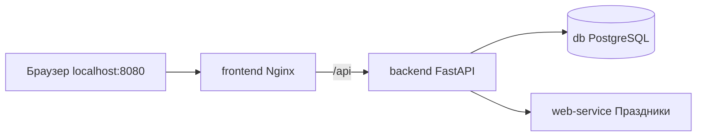

# Лабораторный практикум — Docker Compose, вариант № 28

**Тема:** «Календарь праздников» — получение государственных праздников выбранной страны и хранение производственного календаря.  
**Выполнил:** Савельев Максим Олегович, группа 223-321.

## Что реализовано

Многокомпонентное приложение из **четырёх самостоятельных контейнеров**:

| Контейнер | Технология | Назначение |
|---|---|---|
| `frontend` | Nginx + HTML/CSS/JavaScript | Интерфейс с действующими кнопками и календарём |
| `backend` | Python + FastAPI | REST API, связь между интерфейсом, PostgreSQL и микросервисом, CRUD |
| `db` | PostgreSQL 16 | Сохранённые даты, тип дня, праздник и заметки |
| `web-service` | Python + FastAPI + `holidays` | Получение праздников для страны, расчёт календаря месяца |

Сервисы соединены мостовой сетью Docker Compose `holiday-network`. Nginx проксирует `/api/` в Backend; Backend обращается к Web-сервису через `http://web-service:8001` и к базе по DNS-имени `db`. Порты PostgreSQL и микросервиса наружу не публикуются.



## Требования на компьютере

- Windows 10/11 с запущенным **Docker Desktop** (Linux containers), либо Linux/macOS с Docker Engine и `docker compose`.
- Интернет **при первом запуске**, чтобы скачать образы и Python-пакеты.
- Свободный порт **8080** на компьютере (можно изменить).

## Запуск в Windows

1. Распакуйте ZIP **полностью** в отдельную папку (не запускайте проект внутри архива).
2. Запустите **Docker Desktop** и дождитесь статуса `Engine running`.
3. Откройте терминал в папке, где лежит `docker-compose.yml`, или дважды нажмите `Запустить_в_Docker.cmd`.
4. Выполните в терминале:

   ```powershell
   docker compose up --build -d
   ```

5. Проверьте четыре контейнера:

   ```powershell
   docker compose ps
   ```

6. Откройте **http://localhost:8080**.

Если порт 8080 занят, создайте `.env` на основе `.env.example`, замените `FRONTEND_PORT=8080` на `FRONTEND_PORT=8081`, перезапустите командой `docker compose up -d` и откройте http://localhost:8081.

## Проверка варианта 28

1. В интерфейсе выберите **Россия**, **2026**, **январь**.
2. Нажмите **«Получить календарь из Web-сервиса»**. Появятся календарь, праздничные дни (например, Новый год) и статистика рабочих/выходных дней.
3. Нажмите **«Показать данные из БД»**. Должны появиться начальные записи, созданные автоматически `db/init.sql`.
4. Нажмите **«Сохранить месяц в БД»**. В таблице PostgreSQL появятся все дни января. Повторное сохранение обновит эти записи без дубликатов.
5. В нижней таблице нажмите **«Заметка»**, измените комментарий; затем можно проверить удаление через **«Удалить»**.
6. Остановите и повторно запустите контейнеры. Записи и заметки останутся благодаря именованному тому `postgres_data`.

Для демонстрации разных стран можно выбрать **Германия**, **США** или **Великобритания**. Микросервис считает общегосударственные праздники через библиотеку `python-holidays`; значения зависят от страны и года.

### REST API

| Метод | Путь | Назначение |
|---|---|---|
| GET | `/api/health` | Проверка Backend и PostgreSQL |
| GET | `/api/calendar?country=RU&year=2026&month=1` | Backend обращается к отдельному Web-сервису |
| GET | `/api/saved?country=RU&year=2026&month=1` | Выборка сохранённых дат из PostgreSQL |
| POST | `/api/save-month` | Добавление или актуализация календарного месяца |
| PATCH | `/api/saved/{id}` | Редактирование заметки |
| DELETE | `/api/saved/{id}` | Удаление сохранённой даты |

Пример POST для PowerShell (необязательно):

```powershell
Invoke-RestMethod -Uri http://localhost:8080/api/save-month -Method Post -ContentType 'application/json' -Body '{"country":"RU","year":2026,"month":1}'
```

### Важное ограничение

Это **учебный** производственный календарь для стандартной пятидневной недели. Библиотека `holidays` предоставляет общегосударственные праздники и часть правил наблюдаемых выходных, однако **полный официальный график переносов рабочих дней, региональные праздники и специальные рабочие субботы могут учитываться не полностью**. Не применяйте расчёты как официальный табель рабочего времени.

## Команды для защиты и диагностики

```powershell
docker compose ps                      # состояние всех четырёх контейнеров
docker compose logs --tail=100         # сообщения контейнеров
docker compose logs backend            # логи Backend
docker compose logs web-service        # логи праздничного сервиса
docker compose down                    # остановить, данные PostgreSQL сохранятся
docker compose up -d                   # запустить снова
```

⚠ **Не используйте** `docker compose down -v`, если нужно сохранить данные: флаг `-v` удалит том PostgreSQL.

## Файлы проекта

```text
.
├── docker-compose.yml
├── .gitignore
├── .env.example
├── README.md
├── Запустить_в_Docker.cmd
├── Остановить_Docker.cmd
├── frontend/
│   ├── Dockerfile
│   ├── nginx.conf
│   ├── index.html
│   ├── styles.css
│   └── app.js
├── backend/
│   ├── Dockerfile
│   ├── main.py
│   └── requirements.txt
├── db/
│   └── init.sql
└── web-service/
    ├── Dockerfile
    ├── service.py
    └── requirements.txt
```

## GitHub и сдача

1. Создайте отдельный публичный репозиторий, например `docker-holiday-calendar-v28`.
2. Загрузите файлы из распакованной папки в корень репозитория (`.env` не публикуйте, файл `.env.example` публиковать можно).
3. Скопируйте адрес репозитория в Google-таблицу преподавателя напротив своего варианта № 28.
4. Для защиты сделайте скриншоты `docker compose ps`, веб-интерфейса с календарём, сохранения месяца и чтения данных PostgreSQL.

## Безопасность

В Docker Compose задан демонстрационный пароль по умолчанию **только для локального использования**. Для реального размещения задайте случайный пароль через `.env` и настройте HTTPS, права доступа и аутентификацию. Не коммитьте настоящий `.env` в GitHub.
