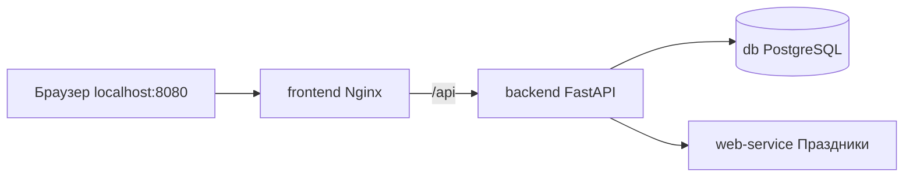

# Лабораторный практикум — Docker Compose, вариант № 28

**Тема:** «Календарь государственных праздников России» — получение праздничных дат и формирование учебного производственного календаря. Основная страна — Россия (`RU`); для демонстрации предусмотрен выбор других стран.  
**Выполнил:** Савельев Максим Олегович, группа 223-321.

## Что реализовано

Многокомпонентное приложение из **четырёх самостоятельных контейнеров**:

| Контейнер | Технология | Назначение |
|---|---|---|
| `frontend` | Nginx + HTML/CSS/JavaScript | Интерфейс с действующими кнопками и календарём |
| `backend` | Python + FastAPI | REST API, связь между интерфейсом, PostgreSQL и микросервисом, CRUD |
| `db` | PostgreSQL 16 | Сохранённые даты, тип дня, праздник и заметки |
| `web-service` | Python + FastAPI + `holidays` | Получение праздников для страны, расчёт календаря месяца |

Сервисы соединены мостовой сетью Docker Compose `holiday-network`. Nginx проксирует `/api/` в Backend; Backend обращается к Web-сервису через `http://web-service:8001` и к базе по DNS-имени `db`. Порты PostgreSQL и микросервиса наружу не публикуются.



## Запуск приложения

Для работы необходимы Docker и Docker Compose. Из корневой папки проекта выполните:

```sh
docker compose up --build -d
docker compose ps
```

В составе приложения запускаются четыре контейнера: `frontend`, `backend`, `db` и `web-service`. Веб-интерфейс доступен по адресу **http://localhost:8080**.

В Windows приложение также можно запустить двойным щелчком по `savelev.bat` (Docker Desktop должен быть запущен). При повторном запуске достаточно выполнить `docker compose up -d`. PostgreSQL использует именованный том `postgres_data`, поэтому данные сохраняются при обычной остановке контейнеров.

**Очистка сохранённых данных:** `clear-db.bat` предлагает два действия — удалить только заметки либо удалить все сохранённые записи календаря. Оба действия требуют подтверждения. Скрипт выполняет SQL непосредственно в контейнере `db`, не удаляя саму базу или её таблицы. Если необходимо сохранить записи, не выбирайте полную очистку.

## Проверка варианта 28

1. В интерфейсе выберите **Россия**, **2026** (или **2027**) и **январь**.
2. Нажмите **«Получить календарь из Web-сервиса»**. Появятся календарь, праздничные дни (например, Новый год) и статистика рабочих/выходных дней.
3. Нажмите **«Показать данные из БД»**. Для января 2026 года доступны демонстрационные записи из `db/init.sql`; для другого месяца до сохранения список может быть пустым.
4. Нажмите **«Сохранить месяц в БД»**. В таблице PostgreSQL появятся все дни выбранного месяца. Повторное сохранение обновит записи без дубликатов и сохранит заметки.
5. В нижней таблице нажмите **«Заметка»**, сохраните комментарий и повторно загрузите записи. Кнопка **«Удалить»** позволяет отдельно проверить удаление записи.
6. Выполните `docker compose down`, затем `docker compose up -d` и снова загрузите записи из базы. Записи и заметки должны сохраниться благодаря тому `postgres_data`.

Для демонстрации разных стран можно выбрать **Германия**, **США** или **Великобритания**. Микросервис считает общегосударственные праздники через библиотеку `python-holidays`; значения зависят от страны и года.

### REST API

| Метод | Путь | Назначение |
|---|---|---|
| GET | `/api/health` | Проверка Backend и PostgreSQL |
| GET | `/api/calendar?country=RU&year=2026&month=1` | Backend обращается к отдельному Web-сервису |
| GET | `/api/saved?country=RU&year=2026&month=1` | Выборка сохранённых дат из PostgreSQL |
| POST | `/api/save-month` | Добавление или актуализация календарного месяца |
| PATCH | `/api/saved/{id}` | Редактирование заметки |
| DELETE | `/api/saved/{id}` | Удаление сохранённой даты |

Пример POST для PowerShell (необязательно):

```powershell
Invoke-RestMethod -Uri http://localhost:8080/api/save-month -Method Post -ContentType 'application/json' -Body '{"country":"RU","year":2026,"month":1}'
```

### Важное ограничение

Это **учебный** производственный календарь для стандартной пятидневной недели. Библиотека `holidays` предоставляет общегосударственные праздники и часть правил наблюдаемых выходных, однако **полный официальный график переносов рабочих дней, региональные праздники и специальные рабочие субботы могут учитываться не полностью**. Не применяйте расчёты как официальный табель рабочего времени.

## Команды для защиты и диагностики

```powershell
docker compose ps                      # состояние всех четырёх контейнеров
docker compose logs --tail=100         # сообщения контейнеров
docker compose logs backend            # логи Backend
docker compose logs web-service        # логи праздничного сервиса
docker compose down                    # остановить, данные PostgreSQL сохранятся
docker compose up -d                   # запустить снова
```

⚠ **Не используйте** `docker compose down -v`, если нужно сохранить данные: флаг `-v` удалит том PostgreSQL.

## Файлы проекта

```text
.
├── docker-compose.yml
├── .gitignore
├── .env.example
├── README.md
├── savelev.bat
├── clear-db.bat
├── frontend/
│   ├── Dockerfile
│   ├── nginx.conf
│   ├── index.html
│   ├── styles.css
│   └── app.js
├── backend/
│   ├── Dockerfile
│   ├── main.py
│   └── requirements.txt
├── db/
│   └── init.sql
└── web-service/
    ├── Dockerfile
    ├── service.py
    └── requirements.txt
```

## Репозиторий и сдача

**Исходный код:** [s1ckw0w/calendar-savelev](https://github.com/s1ckw0w/calendar-savelev).

Для лабораторного практикума подготовлены четыре сервиса Docker Compose, интерфейс с функциональными кнопками, REST API и таблица PostgreSQL с автоматической инициализацией. Работа приложения проверяется по последовательности из раздела «Проверка варианта 28».

В Google-таблице группы необходимо указать ссылку **https://github.com/s1ckw0w/calendar-savelev** напротив студента Савельева Максима Олеговича, группа 223-321, вариант № 28.

При демонстрации достаточно показать `docker compose ps`, работающий сайт, получение праздников России через Web-сервис и чтение/изменение сохранённых данных PostgreSQL.

**Дополнительная проверка API** после запуска контейнеров (при наличии Python на компьютере):

```powershell
python tests/test_calendar_service.py
```

Скрипт проверяет доступность Backend, получение календаря и сохранение 31 дня января 2026 года в PostgreSQL.

## Безопасность

В Docker Compose задан демонстрационный пароль по умолчанию **только для локального использования**. Для реального размещения задайте случайный пароль через `.env` и настройте HTTPS, права доступа и аутентификацию. Не коммитьте настоящий `.env` в GitHub.
